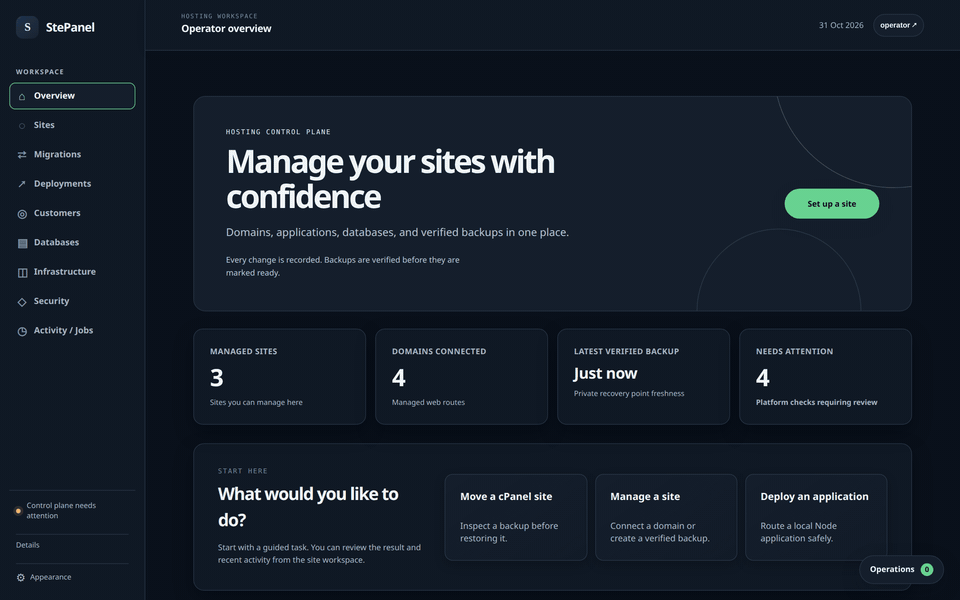
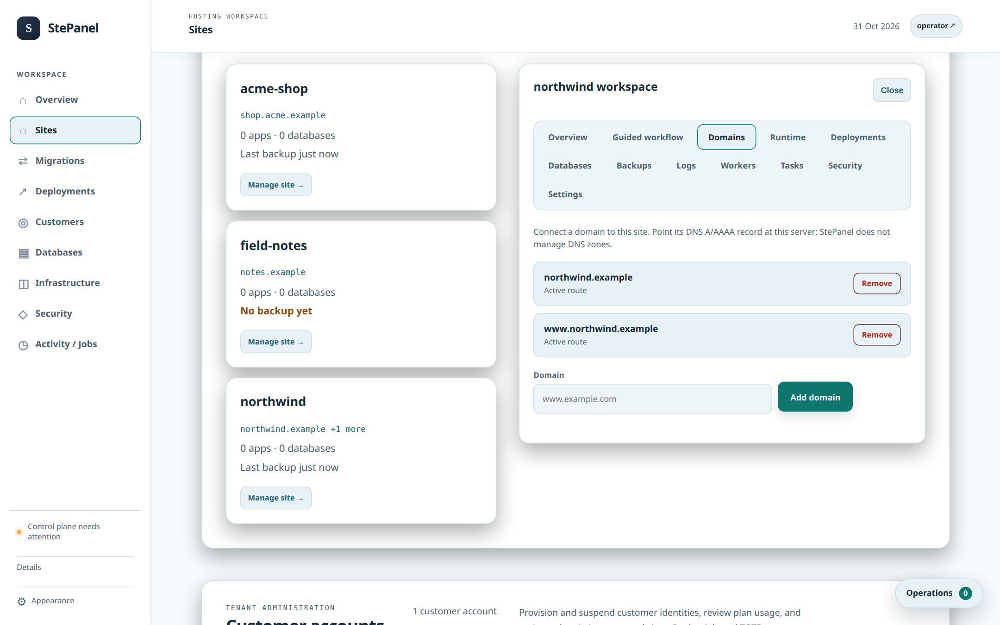
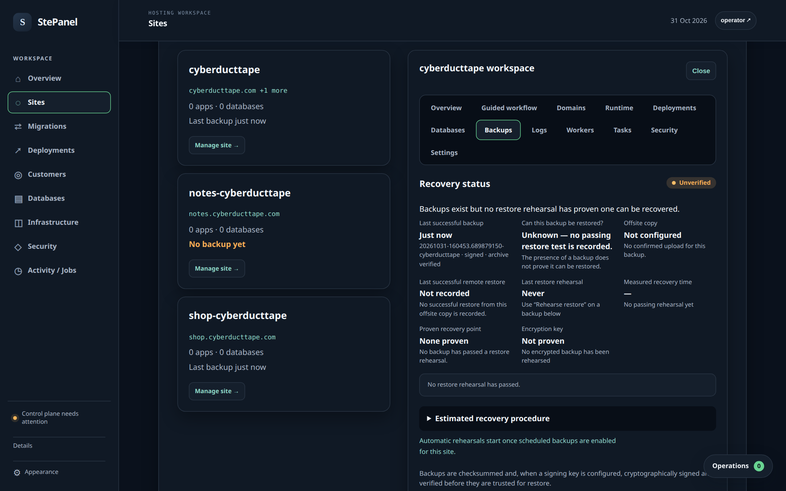
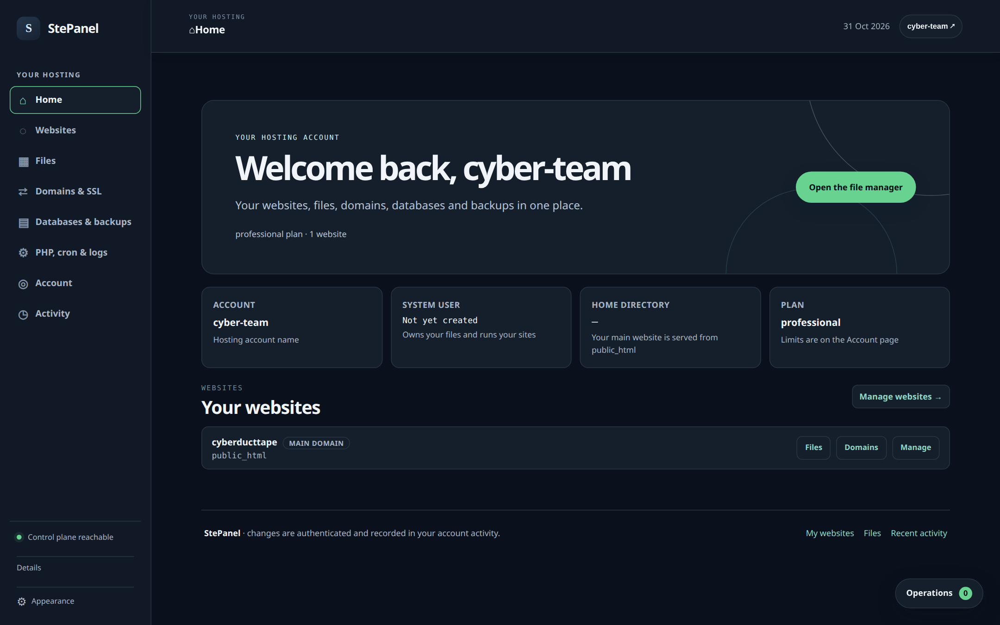
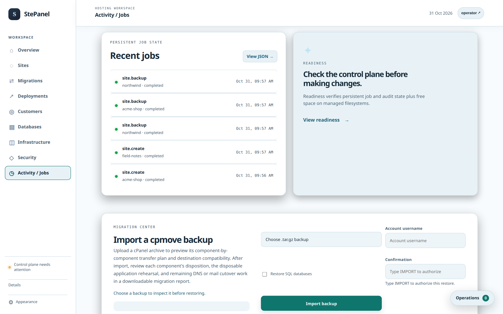

# StePanel

**An open-source Linux hosting control panel that proves its backups work.**
Manage PHP and WordPress sites, databases, TLS, deployments, and backups on
your own server, and move off cPanel with a migration that checks every
archive before it touches your host.

[](https://github.com/cyberducttape/StePanel/actions/workflows/ci.yml)
[](https://github.com/cyberducttape/StePanel/actions/workflows/install-smoke.yml)
[](https://github.com/cyberducttape/StePanel/releases)
[](LICENSE)

> **Status: Operator Beta.** StePanel runs real single-server installations
> today and is ready for experienced Linux administrators who test restores
> before trusting them. It is not yet certified for production hosting:
> repeated failure-recovery runs and a measured capacity limit are still in
> progress. Everything we claim is backed by a CI run you can open; see
> [what is proven](docs/PROOF.md) and the [release gates](docs/V1_PRODUCTION_GATES.md).



<table>
<tr>
<td width="50%"><br><sub>Each site has its own workspace: domains, runtime, deployments, databases, backups, logs, workers, and tasks.</sub></td>
<td width="50%"><br><sub>Recovery status says what has actually been proven: signed backups, restore rehearsals, and recovery point.</sub></td>
</tr>
<tr>
<td><br><sub>Customers sign in with MFA and see only their assigned sites, plan, and usage.</sub></td>
<td><br><sub>Every backup, restore, and site change runs as a durable job you can follow.</sub></td>
</tr>
</table>

The preview images use StePanel's dark appearance and CyberDuctTape demo
branding. These are screenshots of the real UI, captured with synthetic data by
[`scripts/capture-screenshots.sh`](scripts/capture-screenshots.sh). See
[SCREENSHOTS.md](docs/SCREENSHOTS.md) for every view and how they are produced.

## Who it is for

- **Freelancers and small agencies** running client sites on one VPS who want
  a clean panel without a per-account licence.
- **Teams leaving cPanel** who need their sites and databases moved, and
  their mailboxes staged, with a plan they can review first.
- **Administrators who care about recovery**: every backup is signed and
  verified, and restore rehearsals report what has actually been proven.

It is not yet the right choice for hosting providers that sell space to
untrusted customers: sites share one kernel, and multi-server high
availability is not on the 1.0 roadmap.

## Why StePanel?

- **Recovery you can check, not assume.** Backups are signed and verified,
  restores run as durable jobs that survive restarts, database restores take
  a safety backup first, and the panel shows which restores have been
  rehearsed. The project publishes its own
  [crash and recovery test results](docs/PROOF.md).
- **Migrations that look before they leap.** cPanel archives are inspected,
  staged privately, and checked against the destination before anything is
  imported. Unsafe entries are rejected, not skipped silently.
- **Small and understandable.** One Go control plane, narrow root-owned
  helpers, systemd services, and plain documentation.
- **An audit trail you can trust.** Security-relevant actions are recorded in
  a tamper-evident chain, with optional signed checkpoints off the host.
- **Stack choices with explicit evidence.** Ubuntu 24.04, AlmaLinux 9, and
  Rocky Linux 9 with Caddy or Apache and MariaDB have one-iteration Beta
  install evidence; Ubuntu 24.04 + Caddy + MariaDB is the recommended profile.
  Debian 12 is experimental. PostgreSQL, alternate MySQL configurations, and
  OpenLiteSpeed are outside the current installed-host matrix. Check the
  [platform evidence](docs/INSTALLATION.md#supported-operating-systems) before
  choosing a host or database.

## Get started

| I want to... | Start here |
| --- | --- |
| Preview StePanel locally, no host setup | [Run it locally](#local-evaluation) |
| Try a native install on a disposable/staging server | [Current-source Operator Beta guide](docs/INSTALLATION.md#guided-install-from-current-source) (recommended: Ubuntu 24.04 + Caddy + MariaDB) |
| Install for customer production | **Not ready yet.** No published stable archive is certified for a fresh install; review the [production gates](docs/V1_PRODUCTION_GATES.md) before planning deployment. |
| Move a cPanel account | [cPanel migration guide](docs/CPMOVE_IMPORTS.md) |
| See how it compares | [StePanel vs. cPanel, Plesk, HestiaCP, CloudPanel](docs/COMPARISON.md) |

## Current capabilities

| Area | Included today |
| --- | --- |
| Installation | Current-source Beta path; recommended Ubuntu 24.04 + Caddy + MariaDB. Other OS, web-server, and database combinations have different evidence tiers; check the [platform matrix](docs/INSTALLATION.md#supported-operating-systems). |
| Migration | cPanel `.tar.gz` inspection, safe staging, website, SQL, staged mailbox restore, and fail-closed `.htaccess` conversion for Caddy |
| Operations | Dashboard, health endpoint, metrics endpoint, audit log, asynchronous restore jobs |
| Control plane | Durable SQLite state, independently supervised worker, leases/retries/cancellation, dead-letter readiness gate, desired-state reconciliation, and recovery inventory |
| Security | bcrypt credentials, signed sessions, CSRF protection, archive traversal checks, restricted service user, API token scopes, cross-tenant authorization boundaries, privilege escalation prevention, adversarial test coverage |
| Production Readiness | Startup validation of filesystem quotas, encryption keys, TLS configuration; diagnostic endpoint for production prerequisites; comprehensive security test matrix |
| Delivery | Dockerfile, ARM64/AMD64 release workflow, checksums, CI, vulnerability scanning |

The supported-by-evidence Operator Beta combinations and certification limits
are listed in the [installation platform matrix](docs/INSTALLATION.md#supported-operating-systems).

For cloud inventory/actions, DNS adapters, SSH inventory, WAF capability
constraints, off-site backups, and operational configuration, see the
[integration guide](docs/INTEGRATIONS.md), [installation guide](docs/INSTALLATION.md),
[operations runbook](docs/OPERATIONS.md), [customer workflows](docs/CUSTOMER_WORKFLOWS.md), and [version compatibility and rollback](docs/COMPATIBILITY.md).

<details>
<summary>Tenant isolation and production limits in detail</summary>

> **Status:** StePanel supports single-host operation with tenant-scoped account provisioning (TOTP MFA, assigned-site limits, plan-limited site creation by tenant owners, delegated roles, scoped access, resource profiles, and a customer plan/usage panel). Tenants are separated in the control plane and by Unix user and cgroup on the host, but sites share one kernel and network, so StePanel is not a security boundary between hostile customers; see [what tenant isolation covers](SECURITY.md#what-tenant-isolation-does-and-does-not-mean). Multi-tenant production deployment is NOT RECOMMENDED yet: provider-wide audit segregation, HA datastore/failover, and cross-host durable job routing remain open platform requirements. See [PRODUCTION_READINESS.md](docs/PRODUCTION_READINESS.md) for detailed capability status. Administrators can inspect verified local restore dependencies through the authenticated `/api/capabilities` endpoint; remote backup access and each artifact's integrity are checked when an operation runs. Always run behind authenticated HTTPS and test restores against a disposable server before using production data.

</details>

## Architecture at a glance

```text
Browser / API client
        │ authenticated HTTPS
        ▼
Go control plane ── durable jobs, audit chain, desired state
        │ narrow typed helper calls
        ▼
Root-owned platform helpers ── Caddy/Apache, PHP-FPM, databases, systemd
        │ isolated site identities and cgroup profiles
        ▼
Web applications, databases, verified backups, recoverable releases
```

See [SCREENSHOTS.md](docs/SCREENSHOTS.md) for every dashboard view, captured
from the real UI with synthetic data.

Operational key backup and rotation procedures are documented in
[`docs/SECRETS.md`](docs/SECRETS.md).

### Local development

Requirements: Go 1.21 or later with automatic toolchain selection, or the
bootstrap utilities `curl`/`wget`, `tar`, and `sha256sum`. Without a suitable
Go command, the first build downloads the pinned Go 1.26.11 toolchain into a
temporary directory and verifies its SHA-256; no system Go installation is
needed.

```sh
git clone --depth 1 https://github.com/cyberducttape/StePanel.git
cd StePanel
make check
go run ./cmd/stepanel
```

Open <http://localhost:8080>. Local development uses `data/imports` and `data/www`, so root access is not required.

### Local evaluation

To look around without installing services or changing a host, use the
development server from a checkout:

Requirements: Git and either Go 1.21 or later with automatic toolchain
selection, or `curl`/`wget`, `tar`, and `sha256sum`. If needed, the launcher
downloads the pinned Go 1.26.11 toolchain to a temporary directory and verifies
it before building; the initial download requires internet access.

```sh
git clone --depth 1 https://github.com/cyberducttape/StePanel.git
cd StePanel
make evaluate
```

This builds with the repository's pinned Go toolchain and opens
<http://127.0.0.1:8080>. Stop it with Ctrl-C. This is a local UI and workflow
evaluation only: development mode is not production-authenticated, does not
install the root broker, web server, PHP-FPM, or database service, and does not
establish backup recoverability. The evaluation launcher opts into a synthetic
administrator with no login barrier, and is accepted only for unauthenticated
development on the validated loopback listener. Keep that listener at its
default; do not expose this mode to a network or use it for customer or
production data. It writes
development state below the checkout's `data/` directory. For a host-level
Operator Beta evaluation, follow the guided native installation below and
review its preflight before accepting any changes.

### Container

The container packages the control plane only. It does not run Apache, PHP, or
a database server inside the container. Database administrator packages are
host integrations and are not installed in the container image. Treat Docker
and Kubernetes as control-plane packaging for evaluation or limited
integration mode: they are not highly available and cannot provide the native
host-management surface. Use the systemd installation for full single-host
hosting. The production readiness report detects a Docker, Podman or
Kubernetes runtime and flags it with a Deployment Mode warning.

```sh
docker build -t stepanel:local .
ADMIN_TOTP_SECRET="$(openssl rand 20 | base32 | tr -d '=\n')"
printf 'Save and enroll this administrator TOTP secret before continuing: %s\n' "$ADMIN_TOTP_SECRET"
docker run --rm -p 127.0.0.1:8080:8080 \
  -e STEPANEL_TLS_TERMINATED=1 \
  -e STEPANEL_ADMIN_PASSWORD='use-a-password-manager' \
  -e STEPANEL_SESSION_SECRET="$(openssl rand -hex 32)" \
  -e STEPANEL_AUDIT_KEY="$(openssl rand -hex 32)" \
  -e STEPANEL_ADMIN_TOTP_SECRET="$ADMIN_TOTP_SECRET" \
  -e STEPANEL_ACCOUNT_KEY="$(openssl rand -hex 32)" \
  -e STEPANEL_ENVIRONMENT_KEY="$(openssl rand -hex 32)" \
  -e STEPANEL_BACKUP_SIGNING_KEY="$(openssl rand -hex 32)" \
  -e STEPANEL_BACKUP_ENCRYPTION_KEY="$(openssl rand -hex 32)" \
  -e STEPANEL_REQUIRE_OFFSITE_BACKUP=1 \
  -e STEPANEL_OFFSITE_TARGET='s3:bucket/stepanel' \
  -e STEPANEL_SKIP_QUOTA_CHECK=1 \
  -e RCLONE_CONFIG=/run/secrets/rclone.conf \
  -v "$PWD/rclone.conf:/run/secrets/rclone.conf:ro" \
  stepanel:local
```

The image can run with production safety settings and requires TOTP, an account key, an
environment key, a backup signing key (each at least 32 machine-generated
characters), a backup encryption key, and a working offsite rclone target. The
Docker example sets `STEPANEL_SKIP_QUOTA_CHECK=1` because ordinary container
filesystems do not provide the native `/var/www` user-quota contract; this is
evaluation/integration mode, not a substitute for the native production
installer. The generated keys above are
for a throwaway trial: for a real installation generate them once, store them in
your secret manager, and back them up, because encrypted environment state and
signed backups cannot be read without them. This local example binds the
published port to host loopback. `STEPANEL_TLS_TERMINATED=1` means the container
must be reachable only through a trusted HTTPS reverse proxy. For production
reverse-proxy deployments, use a private container network or explicit firewall
policy and configure `STEPANEL_TRUSTED_PROXY_CIDRS` for the proxy's actual
addresses; never publish the HTTP port directly to an untrusted network. Mount
provider credentials through your secret manager; do not bake them into the
image.

### Native installation status

There is no currently published stable release archive supported for a fresh
installation on Ubuntu 24.04. The latest stable archive, v0.7.0, has known
fresh-install defects on that platform; the `0.8` tag is an unsupported
pre-release snapshot. Do not use either archive to create a new host. See the
[version compatibility record](docs/COMPATIBILITY.md#supported-upgrade-paths)
before using an older archive for an existing installation.

For a disposable host or staging environment, the current-source guided
installer builds both binaries as your user and starts the native installer.
It requires Git and either Go 1.21 or later, or curl/wget, tar, and sha256sum; the
[installation guide](docs/INSTALLATION.md#guided-install-from-current-source)
has copyable Ubuntu 24.04 prerequisite commands and explains the first-build
toolchain download:

```sh
git clone --depth 1 --branch main https://github.com/cyberducttape/StePanel.git
cd StePanel
./scripts/install-guided.sh
```

This is an Operator Beta path, not a production-certified release. Its
recommended profile is Ubuntu 24.04 + Caddy + MariaDB; review the current
[platform evidence and prerequisites](docs/INSTALLATION.md#supported-operating-systems)
before using a host. To explore only the interface without host changes, use
[`make evaluate`](#local-evaluation) instead.

The installer records the selected database engine/version, creates a restricted `stepanel` service account, writes the requested panel hostname into the selected webserver, and binds the control plane to `127.0.0.1:8090`. Caddy provisions HTTPS automatically; Apache installations must complete TLS termination before signing in.

Production installation requires a working offsite target. Set `RCLONE_CONFIG`
to an absolute path readable by the `stepanel` service account before running
the installer, for example with `sudo env RCLONE_CONFIG=/etc/stepanel/rclone.conf
./install.sh`. The installer preserves this explicitly supported child-process
setting in `/etc/ste-panel.env`, and its post-install readiness probe verifies
that the configured target can write, read, and delete a health object.

Safety-invariant bypasses (`STEPANEL_SKIP_QUOTA_CHECK`,
`STEPANEL_SKIP_STARTUP_DB_RECONCILE`, `STEPANEL_SKIP_STARTUP_HOST_RECONCILE`,
`STEPANEL_LAB_HTTP_COOKIES`, `STEPANEL_LAB_DIRECT_ROOT_BROKER`) exist only for
disposable lab hosts. The installer refuses to run while any of them is set in
the environment or in an existing `/etc/ste-panel.env`, unless you pass
`./install.sh --unsafe-lab`, which also records `STEPANEL_UNSAFE_LAB=1`. A
production panel refuses to start with a bypass but without that marker; with
it, startup logs a critical warning, writes a
`control_plane.safety_bypass_active` audit event, and
`/api/admin/production-readiness` reports a critical failure.

Nightly/manual installation smoke CI exercises real disposable systemd hosts
for AlmaLinux, Rocky Linux, Ubuntu, and Debian, including package installation,
service restart, synthetic site creation, and selected-webserver validation.

Verify release provenance and the GitHub attestation before installing on a
production host. The checksum authenticates download integrity; the release
page's SBOM and build-provenance attestation provide the corresponding supply
chain evidence. Building from source is a developer/contributor workflow:
see [Local development](#local-development) and keep it separate from the
normal operator installation path.

After installation, inspect the running binary and build provenance with:

```sh
/opt/stepanel/stepanel version
```

Run `stepanel dr-check` on a host to emit a secret-safe control-plane disaster
recovery manifest. It inventories state files, keys, Git trust material,
external rclone dependencies, site data, and regeneration-only helpers without
copying secret values. Use `stepanel backup-control-plane DEST` to create a
verified SQLite backup, and `stepanel restore-control-plane SOURCE --dry-run`
to validate a candidate before the guarded maintenance-window restore:
`stepanel restore-control-plane SOURCE --replace`.

For API automation, build or install `stepanelctl` and set `STEPANEL_URL` and
`STEPANEL_TOKEN`. `stepanelctl` supports both read-only inspection and
state-changing workflows such as site creation, backup/restore, migration,
and provisioning. `doctor` prints a readable checklist with each check's
result, diagnostic message, and next step; add `--json` for scripts. Other inspection
commands return JSON:

```sh
stepanelctl doctor --production
stepanelctl doctor --json
stepanelctl sites list
stepanelctl site inspect example
stepanelctl jobs list
stepanelctl jobs watch site-create-<id>
```

`doctor --production` checks the production prerequisite report and exits
nonzero when readiness is critical, not configured, or unrecognized. `jobs
watch` polls durable job state until it reaches a terminal result.

## Quick workflows

- Migrate a cPanel account with the [cpmove guide](docs/CPMOVE_IMPORTS.md).
- Restore a WordPress `.wpress` archive with the [WordPress guide](docs/WPRESS_IMPORTS.md).
- Deploy and roll back a site through [Git releases](docs/GIT_DEPLOYMENTS.md).
- Run the [disposable lab](deploy/lab/README.md) before touching production data.

## Documentation

### Core References (Canonical Sources)

Read these to understand what StePanel is, does, and can do:

- **[docs/FEATURES.md](docs/FEATURES.md)** — Authoritative capability matrix and feature status
- **[docs/SECURITY.md](docs/SECURITY.md)** — Threat model, security boundaries, known limitations  
- **[docs/ROADMAP.md](docs/ROADMAP.md)** — Medium-term direction and planned work
- **[docs/CURRENT_STATUS.md](docs/CURRENT_STATUS.md)** — Where each 1.0 release gate stands today
- **[docs/V1_PRODUCTION_GATES.md](docs/V1_PRODUCTION_GATES.md)** — Authoritative 1.0 release gates

### Getting Started

- **[docs/INSTALLATION.md](docs/INSTALLATION.md)** — Installation, configuration, production setup
- **[docs/OPERATIONS.md](docs/OPERATIONS.md)** — Running and managing StePanel
- **[docs/SECRETS.md](docs/SECRETS.md)** — Backup, rotation, and disaster recovery procedures
- **[docs/TROUBLESHOOTING.md](docs/TROUBLESHOOTING.md)** — Diagnosing failed jobs, services, and installs

### Workflows by Use Case

- **[docs/CPMOVE_IMPORTS.md](docs/CPMOVE_IMPORTS.md)** — Migrate from cPanel
- **[docs/WPRESS_IMPORTS.md](docs/WPRESS_IMPORTS.md)** — Restore WordPress `.wpress` archives
- **[docs/ARCHIVE_IMPORTER.md](docs/ARCHIVE_IMPORTER.md)** — Import sites from other hosting providers
- **[docs/GIT_DEPLOYMENTS.md](docs/GIT_DEPLOYMENTS.md)** — Deploy and roll back via Git
- **[docs/CUSTOMER_WORKFLOWS.md](docs/CUSTOMER_WORKFLOWS.md)** — Multi-tenant operations and workflows
- **[docs/SHARED_HOSTING.md](docs/SHARED_HOSTING.md)** — Customer accounts, plans, and the shared-hosting beta boundary

### Architecture & Design

- **[docs/ARCHITECTURE.md](docs/ARCHITECTURE.md)** — System design and components
- **[docs/CODE_ORGANIZATION.md](docs/CODE_ORGANIZATION.md)** — Where code lives: root package, `internal/` packages, binaries
- **[docs/adr/](docs/adr/)** — Architecture Decision Records (immutable design history)
- **[docs/THREAT_MODEL.md](docs/THREAT_MODEL.md)** — Detailed threat analysis and mitigations

### API & Development

- **[docs/API_GUIDE.md](docs/API_GUIDE.md)** — API authentication, permissions, copyable workflows
- **[docs/openapi.yaml](docs/openapi.yaml)** — Machine-readable OpenAPI contract
- **[docs/DEVELOPER_WORKFLOWS.md](docs/DEVELOPER_WORKFLOWS.md)** — Contributor guide and local development

### Evidence & Case Studies

- **[docs/lab-results/2026-10-09-rocky9-kvm-certification.md](docs/lab-results/2026-10-09-rocky9-kvm-certification.md)** — Full recovery matrix, abrupt guest loss, and ENOSPC on a SELinux-enforcing KVM guest
- **[docs/REAL_HOST_FAILURE_MATRIX.md](docs/REAL_HOST_FAILURE_MATRIX.md)** — Which failure scenarios have real-host evidence
- **[docs/lab-results/](docs/lab-results/)** — All dated recovery and certification results
- **[docs/CASE_STUDY.md](docs/CASE_STUDY.md)** — Real-world backup and recovery example

### Integrations & Operations

- **[docs/INTEGRATIONS.md](docs/INTEGRATIONS.md)** — Cloud provider, DNS, and third-party integrations
- **[docs/RELEASING.md](docs/RELEASING.md)** — Release process and artifact generation
- **[docs/INCIDENT_LAB.md](docs/INCIDENT_LAB.md)** — Incident response procedures and drills

### Other Resources

- **[CHANGELOG.md](CHANGELOG.md)** — Version history and release notes
- **[docs/DOCUMENTATION_GUIDE.md](docs/DOCUMENTATION_GUIDE.md)** — How documentation is organized and maintained
- **[CONTRIBUTING.md](CONTRIBUTING.md)** — Contribution guidelines
- **[observability/README.md](observability/README.md)** — Metrics, logging, and monitoring
- **[Release artifacts](https://github.com/cyberducttape/StePanel/releases)** — Binary releases, checksums, SBOM

## API reference

The [API guide](docs/API_GUIDE.md) explains authentication, permissions,
copyable `curl` workflows, asynchronous jobs, backups, migrations, databases,
and customer scope. Use the versioned [OpenAPI contract](docs/openapi.yaml) as
the machine-readable endpoint, schema, response, and authorization reference.

## Configuration

Configuration is intentionally documented in the [installation guide](docs/INSTALLATION.md)
and [secrets/DR guide](docs/SECRETS.md), rather than duplicated on the landing
page. Those references include the complete environment-variable table,
production validation rules, key backup and rotation procedures.

Invalid numeric limits and unsafe production paths are rejected at startup
instead of silently falling back to defaults. Production state paths must be
absolute so service behavior does not depend on its working directory.

Set `STEPANEL_INSTALL_MAIL=1` during installation to install Exim, Dovecot,
and SpamAssassin.

Set `STEPANEL_INSTALL_FTP=1` to install and enable vsftpd. The panel reports
vsftpd in the service inventory. Local users are chrooted to their site root
and passive ports default to `40100-40200`; configure FTPS and create
least-privilege site users before allowing external access. Plain FTP should
only be used on a trusted management network.

Set `STEPANEL_INSTALL_NODE=1 STEPANEL_NODE_VERSIONS=20.18.0,22.14.0` to install
Node versions through NVM. The panel can select an installed version per site
and generate a validated reverse proxy for a local app backend in the selected
webserver.
Managed apps are supervised by per-site systemd units and can be started,
stopped, or restarted through the authenticated API.

Set `STEPANEL_INSTALL_SECURITY=1` to install ClamAV, inotify-based PHP
monitoring, and recoverable quarantine handling. This is a defense-in-depth
layer, not a guarantee against all malware; keep applications patched and use
least-privilege service accounts.
Mailbox contents are preserved in the private mail root and reported by the
restore job; activation still requires destination domain, mailbox, DNS, TLS,
and credential mapping.

## Roadmap

The road to 1.0 is about evidence, not new features: repeated real-host
failure-recovery runs, upgrade and rollback tooling, a stable API policy, and
a security review. [CURRENT_STATUS.md](docs/CURRENT_STATUS.md) tracks where
each release gate stands; see the [roadmap](docs/ROADMAP.md) for the full
plan.

## License

StePanel is released under the [MIT License](LICENSE).
